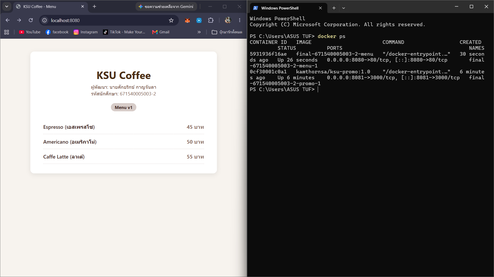
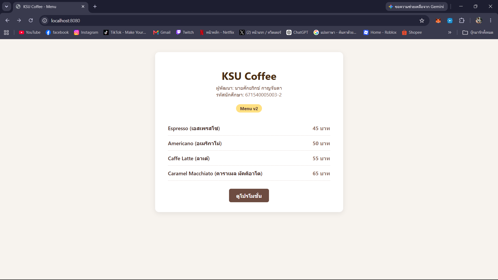
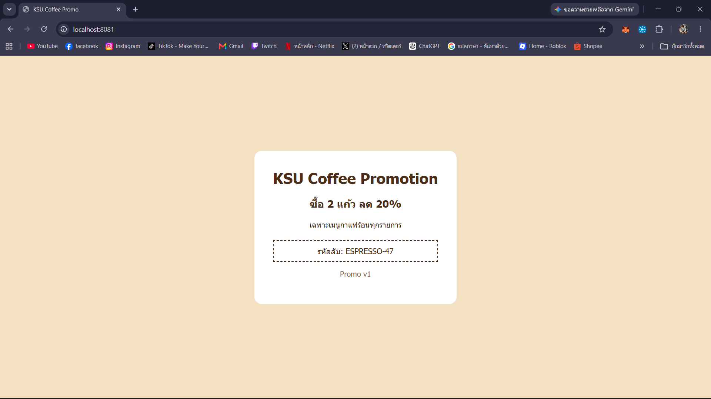

# ANSWER — นายศักยริกข์ กาญจันดา 671540005003-2

## Part A — ข้อมูลจาก image kamthornsa/ksu-promo:1.0

| คำถาม | คำตอบ | คำสั่งที่ใช้ |
| --- | --- | --- |
| Port | 3000/tcp | `docker inspect --format='{{json .Config.ExposedPorts}}' kamthornsa/ksu-promo:1.0` |
| CMD | ["node","server.js"] | `docker inspect --format='{{json .Config.Cmd}}' kamthornsa/ksu-promo:1.0` |
| Base image | node:alpine | `docker history kamthornsa/ksu-promo:1.0` |

## Part B — รหัสลับบนหน้าโปรโมชั่น

ESPRESSO-47

## Part C — คำถาม

1. หน้าโปรโมชั่นรันจาก Image สำเร็จรูปที่ถูกบิลด์แพ็กเกจไว้แล้วบน Docker Hub โดยไม่มี source code ในเครื่องและไม่ได้ทำ Volume Mount จึงไม่สามารถแก้ไฟล์ได้ ส่วนหน้าเมนูมีไฟล์ต้นฉบับ (index.html) อยู่ในเครื่อง จึงแก้ไขแล้วสั่งบิลด์ Image ใหม่ได้
2. เมื่อไม่ระบุ tag ตัว Docker จะดึง tag `latest` เสมอ ซึ่งถ้าบน Docker Hub ไม่มี tag latest จะเกิด error ดึงไม่สำเร็จ หรือถ้ามี tag latest หน้าเว็บอาจเป็นเวอร์ชันอื่นที่ไม่ตรงกับเวอร์ชัน 1.0 ตามที่โจทย์ต้องการ
3. ตัวเลขฝั่งซ้าย (8081) คือ Host Port สำหรับเปิดรับการเชื่อมต่อจากภายนอก/เบราว์เซอร์ ส่วนฝั่งขวา (3000) คือ Container Port ที่แอปพลิเคชันภายในกำลังรันอยู่ ซึ่งสาเหตุที่ฝั่งขวาไม่ใช่ 80 เพราะเว็บเซิร์ฟเวอร์ภายในตัว Image ถูกเขียนให้ listen ที่พอร์ต 3000 (ตาม EXPOSE 3000)
4. จะไม่มีอะไรเปลี่ยนแปลงบนหน้าเว็บ เพราะ Docker Compose จะตรวจสอบเฉพาะ compose file เมื่อไม่มีการเปลี่ยนคอนฟิก มันจะไม่บิลด์ image ใหม่ให้ คำสั่งที่ถูกต้องคือ `docker compose up -d --build` เพื่อบังคับให้บิลด์ image จากโค้ดใหม่ก่อนรัน
5. ใช้ URL `http://localhost:8081` ส่วนการใช้ `http://promo:3000` ไม่ได้เพราะเบราว์เซอร์ทำงานอยู่บนเครื่อง Host ด้านนอกเครือข่ายของ Docker จึงไม่สามารถ resolve ชื่อ service name ผ่าน Docker Internal DNS ได้

## ภาพหน้าจอ

